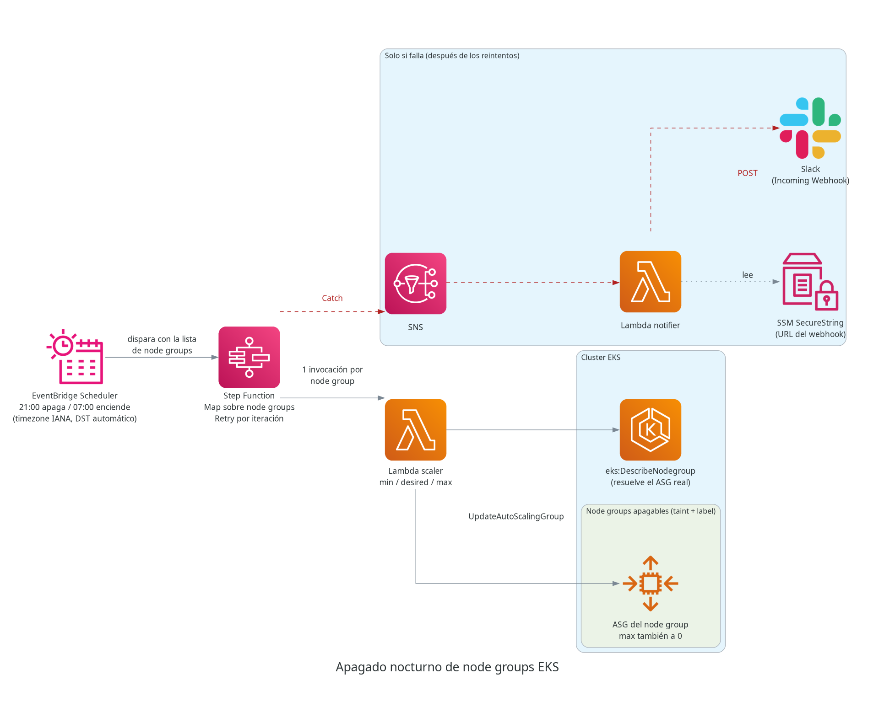
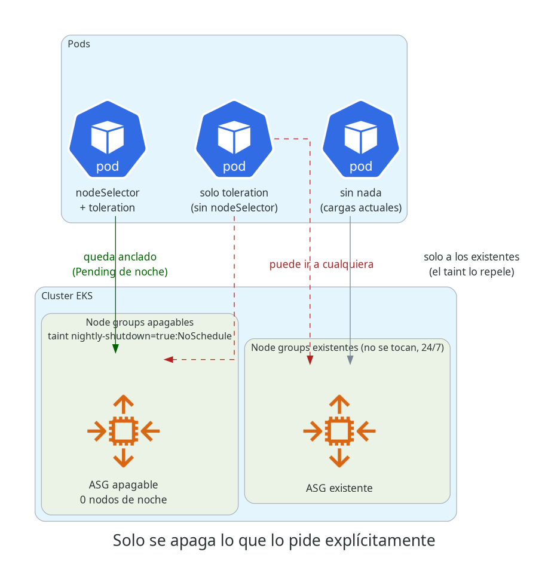

# Kubernetes: apaga esos nodos que no usas

Código y guía paso a paso del artículo sobre el apagado nocturno de node groups en **Amazon EKS**
con EventBridge Scheduler, Step Functions y Lambda.

- Artículo: `<URL-DEL-ARTÍCULO>`
- Diagramas: [`docs/arquitectura.png`](docs/arquitectura.png) y [`docs/aislamiento.png`](docs/aislamiento.png)



## Qué hace

- **EventBridge Scheduler** dispara dos veces por día (apagado y encendido) con un cron en hora
  local y una timezone IANA. El cambio de horario de verano se ajusta solo.
- Una **Step Function** recorre la lista de node groups con un `Map` y `Retry` por iteración.
- La **Lambda "scaler"** resuelve el ASG real de cada node group (`eks:DescribeNodegroup`) y le
  aplica `min` / `desired` / `max`. El `max` también baja a 0 para que Cluster Autoscaler no
  revierta el apagado.
- Si una iteración agota los reintentos, el `Catch` publica en **SNS** y la **Lambda "notifier"**
  avisa por **Slack**, con la URL del webhook leída desde **SSM Parameter Store** (SecureString).
- Solo se apagan los node groups nuevos que crea el ejemplo (con taint + label propios). Los node
  groups que ya tienes en el cluster **no se tocan**.



## Estructura

```
eks-nightly-shutdown/
├── docs/                         # diagramas (PNG) y el código Python que los genera
├── lambda/
│   ├── scaler/handler.py         # escala el ASG de un node group
│   └── notifier/handler.py       # SNS -> Slack
├── manifests/nginx-test.yaml     # Namespace + Deployment de prueba anclado al node group apagable
└── terraform/
    ├── example/                  # root module listo para aplicar (dos node groups + el mecanismo)
    └── modules/
        ├── managed-node-group/   # node group EKS con ignore_changes sobre el scaling_config
        └── nightly-shutdown/     # Scheduler + Step Function + Lambdas + SNS
```

---

## Paso a paso

> **Costo:** el ejemplo crea recursos reales en tu cuenta. El node group `nightly-shutdown-general`
> levanta **1 instancia `t3.large` On-Demand** mientras está encendido; el resto (Lambdas, Step
> Functions, Scheduler, SNS) tiene un costo marginal a este volumen. Al final hay una sección de
> limpieza.

### 0. Requisitos

| Qué | Para qué |
|---|---|
| Un cluster **EKS** existente y acceso con `kubectl` | los node groups se crean dentro de ese cluster |
| Subnets **privadas** del cluster con salida a ECR (NAT o VPC endpoints) | los nodos tienen que poder bajar imágenes ([AWS: managed node groups](https://docs.aws.amazon.com/eks/latest/userguide/managed-node-groups.html)) |
| [Terraform](https://developer.hashicorp.com/terraform/install) >= 1.5.5 | aplicar el ejemplo |
| **Python 3.6+** en la máquina que corre Terraform | `terraform-aws-modules/lambda` empaqueta el código con un script Python ([README del módulo](https://github.com/terraform-aws-modules/terraform-aws-lambda)) |
| [AWS CLI v2](https://docs.aws.amazon.com/cli/latest/userguide/getting-started-install.html) y [`jq`](https://jqlang.org/download/) | los comandos de prueba |
| Permisos IAM para crear roles/policies, Lambda, Step Functions, SNS, EventBridge Scheduler, SSM y node groups EKS | el `apply` |
| Un workspace de Slack donde puedas crear una app | las alertas de fallo |

Cluster Autoscaler **no** es requisito. Si lo tienes instalado, el mecanismo ya contempla que
no revierta el apagado.

Clona el repo y define dos variables que vas a usar en todos los pasos:

```bash
git clone https://github.com/agustin130a/tech-articles.git
cd tech-articles/eks-nightly-shutdown

export AWS_REGION=us-east-1        # la región de tu cluster
export CLUSTER_NAME=my-cluster     # el nombre de tu cluster

aws eks update-kubeconfig --region "$AWS_REGION" --name "$CLUSTER_NAME"
kubectl get nodes                  # debería listar los nodos actuales del cluster
```

### 1. Crear el webhook de Slack

Sigue la guía oficial de [Incoming Webhooks de Slack](https://docs.slack.dev/messaging/sending-messages-using-incoming-webhooks/):

1. Crea una app en [api.slack.com/apps](https://api.slack.com/apps).
2. En la app, activa **Incoming Webhooks**.
3. Haz clic en **Add New Webhook to Workspace** y elige el canal donde quieres las alertas.
4. Copia la URL (`https://hooks.slack.com/services/...`).

La URL es un secreto: cualquiera que la tenga puede publicar en tu canal. No la pegues en el
código ni la subas a ningún repo.

### 2. Guardar el webhook en SSM Parameter Store

Con `read -rs` la URL no queda en el historial de la shell ni se muestra en pantalla:

```bash
read -rs SLACK_WEBHOOK_URL   # pega la URL y presiona Enter

aws ssm put-parameter \
  --region "$AWS_REGION" \
  --name /nightly-shutdown/slack-webhook-url \
  --type SecureString \
  --value "$SLACK_WEBHOOK_URL"

unset SLACK_WEBHOOK_URL
```

### 3. Configurar el ejemplo

```bash
cd terraform/example
cp terraform.tfvars.example terraform.tfvars
```

Lista las subnets del cluster:

```bash
aws eks describe-cluster --region "$AWS_REGION" --name "$CLUSTER_NAME" \
  --query 'cluster.resourcesVpcConfig.subnetIds'
```

Edita `terraform.tfvars`:

- `aws_region` y `cluster_name`: los mismos que exportaste arriba.
- `subnet_ids`: las subnets **privadas** de la lista anterior.
- `schedule_timezone`: tu zona horaria [IANA](https://en.wikipedia.org/wiki/List_of_tz_database_time_zones) (ej. `America/Mexico_City`, `America/Bogota`, `Europe/Madrid`).
- `shutdown_cron_expression` / `startup_cron_expression`: el horario, en **hora local** de esa
  timezone. El formato es el de 6 campos de EventBridge Scheduler
  ([AWS: schedule types](https://docs.aws.amazon.com/scheduler/latest/UserGuide/schedule-types.html#cron-based)).
  Por ejemplo, para apagar solo de lunes a viernes a las 20:00: `cron(0 20 ? * MON-FRI *)`.

### 4. Aplicar

```bash
terraform init
terraform plan
terraform apply
```

Esto crea los dos node groups (`nightly-shutdown-general` con 1 nodo y `nightly-shutdown-incidents`
con 0), las dos Lambdas, la Step Function, el tópico SNS y los dos schedules. Crear un node group
tarda unos minutos.

Confirma que el nodo nuevo se unió al cluster con su label:

```bash
kubectl get nodes -L workload-class
# el nodo nuevo muestra WORKLOAD-CLASS = nightly-shutdown-general
```

Guarda los outputs que vas a usar en los pasos siguientes:

```bash
export SFN_ARN=$(terraform output -raw state_machine_arn)
export ASG_NAME=$(terraform output -json nodegroup_general_asg_names | jq -r '.[0]')
cd ../..
```

### 5. Desplegar la carga de prueba

```bash
kubectl apply -f manifests/nginx-test.yaml
kubectl get pods -n nightly-shutdown-test -o wide
```

El pod tiene que estar `Running` **en el nodo del node group `nightly-shutdown-general`** (compara
la columna `NODE` con la salida de `kubectl get nodes -L workload-class`). Esto funciona porque el
manifest declara las dos cosas: `nodeSelector` (lo obliga a ir a ese node group) y `toleration`
(le permite entrar pese al taint). Con solo la toleration, el pod podría terminar en cualquier otro
node group ([Kubernetes: taints y tolerations](https://kubernetes.io/docs/concepts/scheduling-eviction/taint-and-toleration/)).

### 6. Probar el apagado a mano

No hace falta esperar al cron. Toma el input exacto que usa el schedule de apagado y dispara la
Step Function con él:

```bash
DOWN_INPUT=$(aws scheduler get-schedule --region "$AWS_REGION" \
  --name nightly-shutdown-down --group-name default \
  --query 'Target.Input' --output text)

EXEC_ARN=$(aws stepfunctions start-execution --region "$AWS_REGION" \
  --state-machine-arn "$SFN_ARN" --input "$DOWN_INPUT" \
  --query executionArn --output text)
```

**Verifica cuatro cosas.**

**6.1. El ASG quedó en 0 / 0 / 0** (min / desired / max):

```bash
aws autoscaling describe-auto-scaling-groups --region "$AWS_REGION" \
  --auto-scaling-group-names "$ASG_NAME" \
  --query 'AutoScalingGroups[0].[MinSize,DesiredCapacity,MaxSize]'
# [0, 0, 0]
```

**6.2. La ejecución no pasó por `NotifyFailure`.** Ojo: `SUCCEEDED` por sí solo no prueba nada,
porque el `Catch` hace que una rama fallida también termine "bien":

```bash
aws stepfunctions describe-execution --region "$AWS_REGION" \
  --execution-arn "$EXEC_ARN" --query status

aws stepfunctions get-execution-history --region "$AWS_REGION" \
  --execution-arn "$EXEC_ARN" \
  --query 'events[?type==`TaskStateEntered`].stateEnteredEventDetails.name'
# solo debería aparecer "InvokeScaler", nunca "NotifyFailure"
```

**6.3. El pod pasó a `Pending` y no se fue a otro node group.** El nodo se drena y se termina en
unos minutos:

```bash
kubectl get pods -n nightly-shutdown-test -o wide -w
# cuando quede Pending (Ctrl+C para salir):
kubectl describe pod -n nightly-shutdown-test -l app=nginx-test | tail -5
# en Events: "... node(s) didn't match Pod's node affinity/selector"
# y, si tienes Cluster Autoscaler: "... max node group size reached"
```

**6.4. Los logs de la Lambda muestran el escalado:**

```bash
aws logs tail /aws/lambda/nightly-shutdown-scaler --region "$AWS_REGION" --since 15m
# "ASG ... actualizado a min=0 desired=0 max=0"
```

### 7. Probar el encendido

Lo mismo, con el input del schedule de encendido:

```bash
UP_INPUT=$(aws scheduler get-schedule --region "$AWS_REGION" \
  --name nightly-shutdown-up --group-name default \
  --query 'Target.Input' --output text)

aws stepfunctions start-execution --region "$AWS_REGION" \
  --state-machine-arn "$SFN_ARN" --input "$UP_INPUT"

kubectl get pods -n nightly-shutdown-test -o wide -w
# el pod vuelve a Running cuando el nodo nuevo se une al cluster (unos minutos)
```

El ASG vuelve a los valores `restore_*` definidos en `terraform/example/main.tf` (0 / 1 / 10 para
`nightly-shutdown-general`).

### 8. Probar la alerta de Slack

Para forzar un fallo real sin romper nada, niega temporalmente el permiso de escalar al role de
la Lambda scaler:

```bash
SCALER_ROLE=$(aws lambda get-function-configuration --region "$AWS_REGION" \
  --function-name nightly-shutdown-scaler --query Role --output text | awk -F/ '{print $NF}')

aws iam put-role-policy --role-name "$SCALER_ROLE" \
  --policy-name temp-deny-scaling \
  --policy-document '{
    "Version": "2012-10-17",
    "Statement": [{
      "Effect": "Deny",
      "Action": "autoscaling:UpdateAutoScalingGroup",
      "Resource": "*"
    }]
  }'

sleep 30   # los cambios de IAM tardan unos segundos en propagarse
```

Repite el paso 6 (apagado a mano). Esta vez:

- La Step Function reintenta 3 veces (esperas de 10, 20 y 40 segundos), así que la alerta llega
  a Slack **alrededor de un minuto y medio** después de disparar la ejecución.
- Llega **un mensaje por cada node group** que falló (dos, con el ejemplo tal cual).
- `describe-execution` igual dice `SUCCEEDED`, pero `get-execution-history` ahora muestra
  `NotifyFailure`.

**No te olvides de quitar el `Deny`:**

```bash
aws iam delete-role-policy --role-name "$SCALER_ROLE" --policy-name temp-deny-scaling
```

Después repite el paso 7 para dejar el node group encendido.

### 9. Dejarlo funcionando

Con `schedule_state = "ENABLED"` (el default), los schedules ya están activos: a la hora
configurada se apaga y se enciende solo. Para revisar las ejecuciones automáticas:

```bash
aws stepfunctions list-executions --region "$AWS_REGION" \
  --state-machine-arn "$SFN_ARN" --max-results 5
```

**Para mover una carga real al apagado nocturno**, agrega a su Deployment lo mismo que tiene el
manifest de prueba:

```yaml
spec:
  template:
    spec:
      nodeSelector:
        workload-class: nightly-shutdown-general
      tolerations:
        - key: nightly-shutdown
          operator: Equal
          value: "true"
          effect: NoSchedule
```

Muévela solo si puede quedar `Pending` durante la noche sin que nadie la necesite.

**Para sumar otro node group**, agrega una entrada a la lista `nodegroups` del módulo
`nightly_shutdown`, con sus valores `restore_*`. No hace falta tocar el módulo.

**Para pausar el apagado** (por ejemplo, una noche de deploy), cambia `schedule_state = "DISABLED"`
en `terraform.tfvars` y aplica. Se reactiva volviendo a `ENABLED`.

### 10. Limpieza

```bash
kubectl delete -f manifests/nginx-test.yaml

cd terraform/example
terraform destroy
cd ../..

aws ssm delete-parameter --region "$AWS_REGION" --name /nightly-shutdown/slack-webhook-url
```

Si ya no la vas a usar, elimina también la app de Slack desde [api.slack.com/apps](https://api.slack.com/apps).

---

## Tropiezos que ya están resueltos en el código

1. **Cluster Autoscaler revierte el apagado si `max` no baja.** EKS etiqueta los ASG de los managed
   node groups para que CA los descubra ([AWS](https://docs.aws.amazon.com/eks/latest/userguide/managed-node-groups.html)),
   y CA respeta el `min`/`max` de cada ASG ([CA en AWS](https://github.com/kubernetes/autoscaler/blob/master/cluster-autoscaler/cloudprovider/aws/README.md)).
   La Lambda baja los tres valores.
2. **Las reglas programadas clásicas de EventBridge evalúan el cron en UTC**
   ([AWS](https://docs.aws.amazon.com/eventbridge/latest/userguide/eb-scheduled-rule-pattern.html)).
   Se usa EventBridge Scheduler con timezone.
3. **`policy_statements[*].condition` tiene que ser una lista** en `terraform-aws-modules/lambda`;
   con un objeto suelto no falla hasta el `apply`; `validate` no lo detecta.
4. **`create_current_version_allowed_triggers = false`** en la Lambda notifier: sin `publish = true`
   el permiso de SNS sobre la "current version" falla.
5. **`nodeSelector` + `toleration`, siempre los dos.**
6. **`lifecycle.ignore_changes` sobre el `scaling_config`** del node group, para que un `apply`
   posterior no pelee contra la Lambda.
7. **`SUCCEEDED` no significa que haya escalado**: revisa el historial de la ejecución o la
   alerta de Slack.

## Regenerar los diagramas

```bash
python3 -m venv ~/.venvs/aws-diagrams
~/.venvs/aws-diagrams/bin/pip install diagrams   # requiere Graphviz instalado en el sistema
~/.venvs/aws-diagrams/bin/python3 docs/arquitectura.py
~/.venvs/aws-diagrams/bin/python3 docs/aislamiento.py
```
