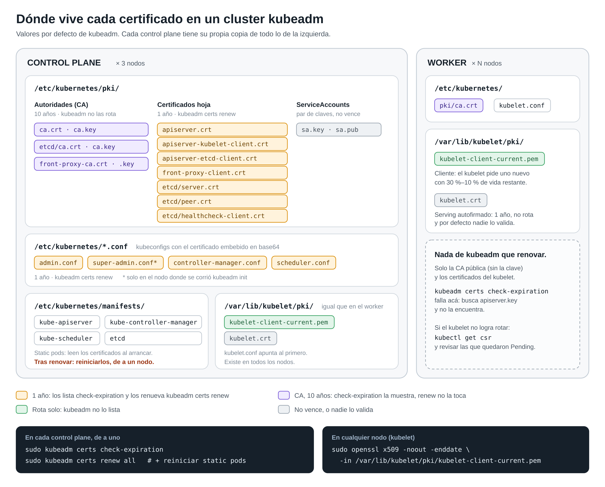

# Certificados de kubeadm: medir el vencimiento y alertar desde Grafana

Código y paso a paso del artículo *"Tu cluster kubeadm tiene fecha de vencimiento"*. Sirve como
workshop: en unos 15 minutos levantas un laboratorio local que expone el vencimiento de los
certificados de un nodo kubeadm como métrica y ves la alerta de Grafana disparar.

```
nodo kubeadm                      node_exporter              Prometheus             Grafana
/etc/kubernetes/pki/*.crt   ─┐                                                     
/etc/kubernetes/*.conf      ─┼─> kubeadm-cert-exporter.sh ─> textfile collector ─> scrape ─> regla < 30 días
/var/lib/kubelet/pki/*      ─┘   (timer cada hora)            kubeadm_cert_*
```

## Qué hay en cada carpeta

| Carpeta | Contenido |
|---|---|
| [`exporter/`](exporter/) | Script que lee los certificados del nodo y escribe `kubeadm_certs.prom`, más el service y el timer de systemd |
| [`alerts/`](alerts/) | Reglas de Grafana (file provisioning), las mismas reglas para Prometheus y sus tests con `promtool` |
| [`helm/`](helm/) | Values de kube-prometheus-stack para habilitar el textfile collector |
| [`lab/`](lab/) | Laboratorio con docker compose: node_exporter, Prometheus y Grafana |
| [`results/`](results/) | Salidas de las pruebas descritas abajo |
| [`docs/`](docs/) | Diagrama de dónde vive cada certificado (`donde-viven.py` lo genera; solo usa la biblioteca estándar) |



## Requisitos

- Docker con el plugin `compose`.
- `openssl`, `base64` y `date` de GNU (cualquier Linux sirve).
- Para la parte en nodos reales: acceso de lectura a un nodo kubeadm (root o `sudo`).

## 1. Laboratorio local

```bash
cd lab
./up.sh       # crea un nodo de prueba con certificados a 20 días y levanta el stack
sleep 60
./check.sh    # días hasta el vencimiento y estado de las reglas de Grafana
```

`up.sh` arma un árbol `/etc/kubernetes` de mentira con `make-fake-node.sh` (CA de 10 años,
`apiserver`, `etcd-server` y un `scheduler.conf` con el certificado embebido en base64, todos a 20 días),
le corre el exportador y copia las reglas de Grafana con evaluación cada 10 segundos.

Resultado esperado (ver [`results/lab-check.txt`](results/lab-check.txt)):

```
  [firing  ] Certificado de kubeadm por vencer (health=ok)
      -> apiserver en lab-cp-1 vence en 20 días
      -> etcd-server en lab-cp-1 vence en 20 días
      -> scheduler.conf en lab-cp-1 vence en 20 días
  [inactive] Exportador de certificados sin datos (health=ok)
  [inactive] Cliente del apiserver con certificado por vencer (health=ok)
```

Grafana queda en <http://localhost:13000> (acceso anónimo de solo lectura): *Alerting → Alert rules*.

Para ver disparar la regla del exportador, envejece el `last_run` de un nodo y espera un par de minutos:

```bash
old=$(( $(date +%s) - 4*3600 ))
sed -i -E "s/^(kubeadm_cert_exporter_last_run_timestamp_seconds\{[^}]*\}) [0-9]+/\1 $old/" textfile/lab-cp-1.prom
```

Para apagar todo: `docker compose down`.

### Sumar nodos reales sin escribir nada en ellos

El exportador tiene un modo `--stdout` que solo imprime. Se puede correr por SSH y guardar la salida
en el laboratorio, sin instalar nada en el nodo:

```bash
ssh root@<nodo> 'HOST_LABEL=cp-1 bash -s -- --stdout' < ../exporter/kubeadm-cert-exporter.sh > textfile/cp-1.prom
```

Los archivos `textfile/cp-*.prom` y `textfile/worker-1.prom` de este repo salieron así de un cluster
real de 3 control planes (con los nombres de host reemplazados). Muestran lo que el artículo cuenta: 356
días en los leaf certs (el cluster se actualizó hace 8 días), entre 121 y 163 días en los certificados de
cliente del kubelet (rotan solos) y −161 días en el serving cert autofirmado del kubelet.

## 2. Tests de las reglas

```bash
docker run --rm -v "$PWD/alerts":/w:ro -w /w --entrypoint promtool prom/prometheus:v3.7.3 \
  test rules prometheus-kubeadm-certs.test.yaml
```

Los casos cubren: un leaf a 20 días (dispara), uno a 100 días (no), la CA y el serving cert del kubelet
(excluidos a propósito), un exportador que dejó de correr, ningún nodo publicando la métrica y el
histograma del apiserver con y sin pedidos en el bucket de 30 días.

## 3. Llevarlo a un cluster

> **Sin probar en un cluster.** Esta sección no se ejecutó en nodos reales: el script se probó en modo
> `--stdout` contra un cluster y en el laboratorio; el flag de node_exporter, solo en docker con la misma
> ruta; las units de systemd, solo con `systemd-analyze verify`. Pruébalo primero en un cluster de
> laboratorio.

En **cada nodo** (control planes y workers):

```bash
sudo install -m 0755 exporter/kubeadm-cert-exporter.sh /usr/local/sbin/
sudo install -m 0644 exporter/kubeadm-cert-exporter.{service,timer} /etc/systemd/system/
sudo systemctl daemon-reload
sudo systemctl enable --now kubeadm-cert-exporter.timer
sudo systemctl start kubeadm-cert-exporter.service
cat /var/lib/node_exporter/textfile_collector/kubeadm_certs.prom
```

En **node_exporter**: si usas kube-prometheus-stack, aplica [`helm/kube-prometheus-stack-values.yaml`](helm/kube-prometheus-stack-values.yaml).
El chart ya monta la raíz del host en `/host/root`, así que alcanza con un flag. Ojo: `extraArgs`
reemplaza la lista entera, por eso el archivo repite los dos valores por defecto.

En **Grafana**: copia [`alerts/grafana-kubeadm-certs.yaml`](alerts/grafana-kubeadm-certs.yaml) a
`provisioning/alerting/` (o a tu mecanismo de provisioning), cambia `datasourceUid` por el de tu
Prometheus y agrega la política de notificación que corresponda al label `severity`.

> La regla 3 (histograma del apiserver) no necesita nada de lo anterior: funciona con cualquier
> Prometheus que ya scrapee el apiserver. Si solo puedes hacer una cosa hoy, empieza por esa.

## Qué no cubre

- Certificados firmados a mano con la CA del cluster (usuarios con kubeconfig propio): no están en
  rutas fijas. Si los tienes, agrégalos al script o, mejor, emítelos con vida corta.
- El reinicio de los static pods después de renovar: el exportador lee el disco. La regla 3 es la que
  ve lo que cada componente tiene cargado en memoria.
- Clusters gestionados (EKS, GKE, AKS): ahí el control plane lo administra el proveedor.

## Fuentes

- [Certificate Management with kubeadm](https://kubernetes.io/docs/tasks/administer-cluster/kubeadm/kubeadm-certs/)
- [PKI certificates and requirements](https://kubernetes.io/docs/setup/best-practices/certificates/)
- [Configure Certificate Rotation for the Kubelet](https://kubernetes.io/docs/tasks/tls/certificate-rotation/)
- [Kubernetes Metrics Reference](https://kubernetes.io/docs/reference/instrumentation/metrics/)
- [node_exporter: Textfile Collector](https://github.com/prometheus/node_exporter#textfile-collector)
- [Grafana: provisioning de alertas por archivo](https://grafana.com/docs/grafana/latest/alerting/set-up/provision-alerting-resources/file-provisioning/)
- [x509-certificate-exporter](https://github.com/enix/x509-certificate-exporter), alternativa en DaemonSet
